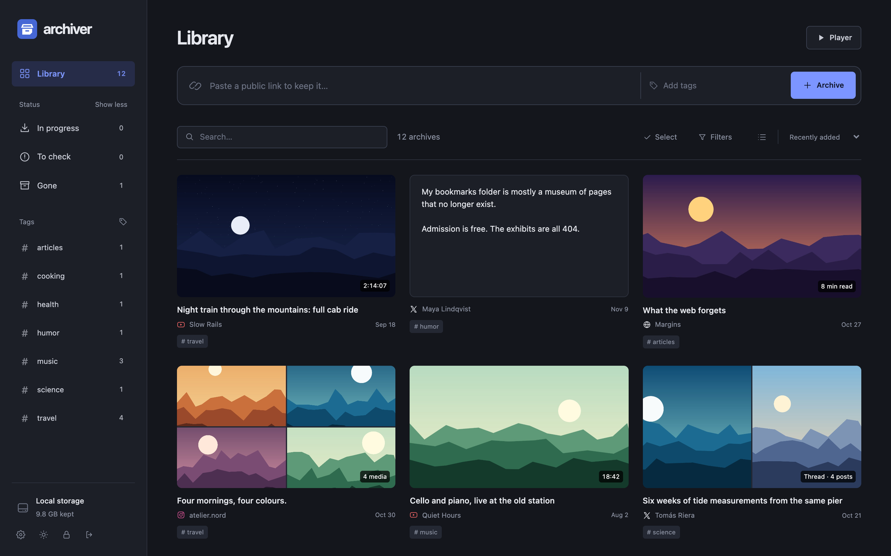
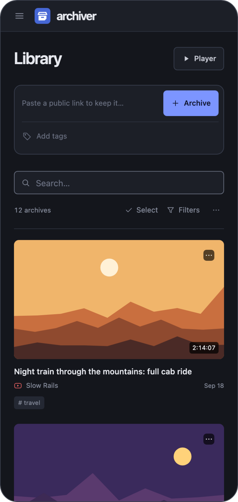

<p align="center">
  
</p>

<h1 align="center">Archiver</h1>

<p align="center">
  <strong>A personal memory of the web.</strong><br>
  Keep what mattered to you online, before it disappears.
</p>

<p align="center">
  
  
  
</p>

<p align="center">
  
  &nbsp;
  
</p>

The web forgets. A video you loved, a thread that made you laugh, an article that stayed with you: one day the link leads nowhere.

Archiver keeps a copy of what mattered to you. Paste a link and it saves the original file, its text and where it came from, in a library that is yours and that you can search years later.

It runs on your own computer or server, for one person, and reads the web as a logged-out visitor would: only public content can be archived.

## Features

- **Any public link.** Archiver works on the whole web: a link is saved as a web page, unless an integration knows its site better. Platforms such as YouTube, X, Instagram, TikTok or Facebook each have one, which keeps videos, whole threads and photo posts as what they are. [More can be added](#development).
- **Originals, untouched.** Files are stored as they were downloaded, in the best quality available.
- **Subtitles.** A video's subtitles are kept with it: its author's, or the automatic transcript in the video's own language. They show on the video and can be searched.
- **Clean articles.** Web pages are saved as text and images, without menus or ads, and open in a reader view.
- **Direct file links.** A link straight to an image, a GIF, a video, a sound or a PDF is kept as that file.
- **From anywhere.** Archive from the web interface, your phone's share menu or the Chrome extension.
- **Tags, notes and search.** Search covers titles, post text, your notes and, when asked, the full text of articles and subtitles. Filter by platform or date.
- **Full-screen player.** Go through your library with the keyboard or a swipe.
- **Private archives.** Hidden until you type your password again.
- **Hard to lose.** Deleted archives wait 30 days in the trash, and a link you already archived is pointed out before it is kept twice.
- **Your storage.** A local disk or any S3-compatible bucket, optionally encrypted before upload.
- **Readable without Archiver.** Every archive carries a plain record of what it is and where it came from. An offline viewer and ZIP exports work without the application.
- **Watched over time.** Files are verified periodically, and a **Gone** view lists the originals that have disappeared from the web.

## Quick start

You need Docker with Docker Compose, on the computer, NAS or server that will keep your library.

```sh
git clone https://github.com/naei/archiver.git
cd archiver
cp .env.example .env
docker compose up -d --build
```

Open **http://localhost:8000**, create your account, paste a link and click **Archive**. Downloads carry on after the tab is closed.

Archiver has a single account, created on first launch: create it right after deploying, since whoever opens the address first can claim it.

Data lives in the `archive-data` Docker volume. `docker compose down` keeps it; **`docker compose down -v` deletes it.**

## Archive from anywhere

In the interface, **Archive from anywhere** (in the settings menu, behind the gear) shows the steps for your device, with your server's address filled in.

| From | How |
| --- | --- |
| Computer | The Chrome extension: in `chrome://extensions`, turn on **Developer mode**, **Load unpacked** the [`extension`](extension) folder, then **Connect**. One click or `Alt+Shift+A` sends the open tab. |
| Android | In Chrome, menu ⋮ → **Install app**. Archiver then appears in the **Share** menu. |
| iPhone, iPad | A Shortcut in the share sheet that opens `https://your-server/share?url=` followed by the shared link. |

Out of the box, Archiver answers only on the machine it runs on. A phone needs to reach it over HTTPS: prefer a private network or a tunnel to an open port on your router.

## Configuration

Settings are environment variables, read from `.env` by Compose. All are optional; [`.env.example`](.env.example) describes them with their defaults.

| Variable | Purpose |
| --- | --- |
| `PORT`, `BIND_ADDRESS` | Where the interface listens. Default `127.0.0.1:8000`. |
| `STORAGE_BACKEND` | `local` (default) or `s3`. |
| `S3_BUCKET`, `S3_PREFIX`, `S3_ENDPOINT_URL`, `AWS_*` | An existing, private bucket and its credentials, for S3 storage. |
| `ENCRYPTION_KEY` | Encrypts files before they are stored. |
| `PROXY`, `PROXY_MODE` | Sends downloads through an HTTP proxy, or a pool of them. |
| `RELAY_TOKEN`, `RELAY_SERVER` | Lets a relay at home archive what the server cannot. |
| `ARCHIVER_FIXITY_DAYS`, `ARCHIVER_CHECK_DAYS` | Days between integrity checks (30) and online checks (7). `0` disables. |

The catalog (a SQLite file) always lives on the `/data` volume, with S3 storage too: keep that volume. Changing the storage does not move existing archives.

### Encrypted storage

With `ENCRYPTION_KEY` set, files are encrypted before they reach the disk or the bucket, in the standard [age](https://age-encryption.org) format, so whoever hosts your storage cannot read them. The key stays with the application: this does not protect them from whoever hosts the application itself. The catalog, file sizes and the number of archives are not hidden.

```sh
docker compose run --rm archiver python run.py keygen
```

Put the printed `ENCRYPTION_KEY=AGE-SECRET-KEY-1...` line in `.env` and restart. **Keep a copy of the key elsewhere: without it, nothing can recover the archives.** New archives are encrypted from then on; `run.py encrypt` converts the existing ones and `run.py decrypt` goes back.

### Home relay

Some sites turn away servers in datacenters while accepting a home connection. A relay is the same application running on your own computer: it archives from home the links your server failed to download, into the S3 storage both share.

Set a secret as `RELAY_TOKEN` on the server. On your computer, write an env file (say `.env.relay`) with the server's S3 settings, its `ENCRYPTION_KEY` if any, the same `RELAY_TOKEN` and `RELAY_SERVER=https://your-server`, then start it. It needs no open port.

```sh
docker compose --env-file .env.relay up -d --build relay
```

## Hosting on a server

Archiver is one container with a persistent volume on `/data`. It runs on a VPS or any host that runs containers.

- Serve it over **HTTPS** through a reverse proxy that forwards `X-Forwarded-Proto` and keeps the original `Host` header.
- Run **a single instance**, without automatic sleep, so background work can finish.
- `/health` is the health check.
- A bind-mounted `/data` must be writable by UID/GID `10001`.
- The host holds the storage credentials and the encryption key. Limit the credentials to the one bucket, and keep a copy of the library that the server cannot reach.

## Commands

Run them inside the container: `docker compose exec archiver python run.py <command>`.

| Command | What it does |
| --- | --- |
| `keygen` | Prints a new encryption key. |
| `encrypt`, `decrypt` | Converts the existing library to or from encrypted storage. |
| `rebuild` | Rebuilds a lost catalog from the `archive.json` records in the storage. |
| `reset-account` | Deletes the account after a forgotten password. Archives are kept. |
| `relay` | Runs as a [home relay](#home-relay), for as long as it is left running. |
| `archive <link>` | Archives one link into the S3 storage from the computer it runs on, as a one-off relay. |

**Backups.** Copy the `/data` volume, or use **Export the library**. With S3, back up the catalog on `/data` too, and your encryption key if you use one.

**Updates.** Sites change often. `git pull`, then `docker compose up -d --build` to refresh Archiver and its dependencies.

## Development

Python 3.12+, FFmpeg and Node.js 22+ are required; Poppler (`pdftoppm`) is optional, for PDF previews. The backend is plain Python with SQLite; the interface is HTML, CSS and JavaScript without a build step.

```sh
python3 -m venv .venv && . .venv/bin/activate
pip install -r requirements.txt
python run.py                                   # http://127.0.0.1:8000, data in ./data
python -m unittest discover -s tests            # tests, without network access
```

- **Adding a platform.** A link that no integration takes is archived as a web page. An integration teaches Archiver one site, so that its videos or threads are kept as such: it is one file in [`archiver/integrations`](archiver/integrations), listed in `MODULES`. The contract is described at the top of [`__init__.py`](archiver/integrations/__init__.py), and [`mastodon.py`](archiver/integrations/mastodon.py) is a short example. Give it an icon in [`web/render.js`](web/render.js) and tests that run without network access.
- **Adding a language.** Copy `en.json` in [`web/locales`](web/locales) and `fr.json` in [`archiver/locales`](archiver/locales) under the language's code, then translate the values, leaving keys and `{braces}` as they are. The extension has its own texts in [`extension/_locales`](extension/_locales).

## Responsible use

Archiver is for personal archiving: a copy, for yourself, of public content you have seen. It logs in to no site and uses none of your browser's cookies, and does not handle private, paid or DRM-protected content. Respect copyright and each site's terms, do not redistribute what you archive, and do not run a public instance for others.

## License

Copyright © 2026 [Lucas Pantanella](https://github.com/naei).

Archiver is free software, released under the [GNU Affero General Public License, version 3](LICENSE). If you run a modified version as a network service, you must offer its source to its users. Dependencies keep their own licenses.

The Archiver name and logo are not licensed with the code. Use them freely on your own instance, but give any public or commercial version its own name and logo.
